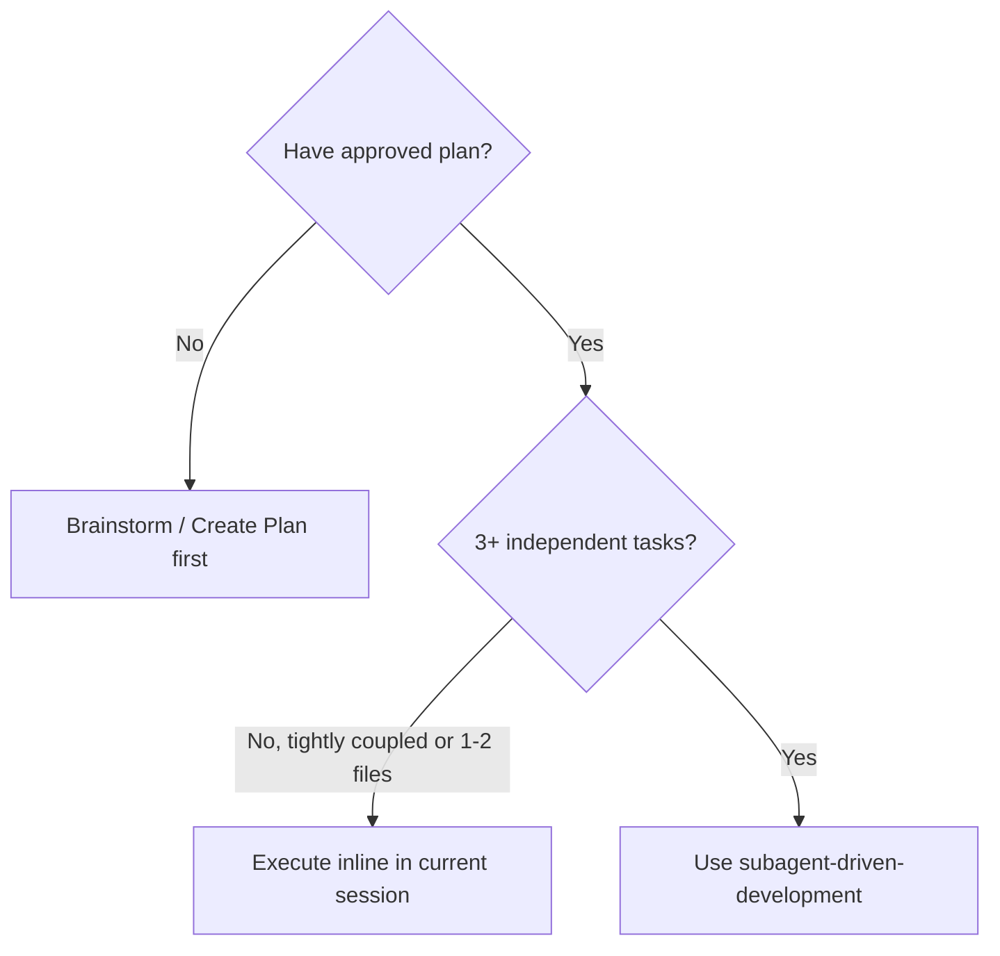

# Subagent-Driven Development (SDD)

> **Adapted from `obra/superpowers` for Antigravity native `invoke_subagent` + Ponytail + Obsidian PKM.**

Execute an approved implementation plan by dispatching a fresh subagent per task, performing a two-stage review (Spec Compliance + Code Quality/Ponytail) after each task, and running a final verification pass at the end.

## Core Principles

1. **Fresh Context per Task:** Subagents (`invoke_subagent` with `TypeName: "self"` or `"research"`) receive only the exact task specification, target file paths, and architectural constraints they need—preventing context pollution.
2. **Two-Stage Review:** Every completed task is verified against:
   - **Stage 1 (Spec Compliance):** Did the subagent build exactly what was requested (no missing items, no unrequested extras)?
   - **Stage 2 (Code Quality & Ponytail):** Does it follow `clean-code` and `ponytail` (no bloat, reuses codebase utilities, minimal footprint, passes build/test)?
3. **Rulings, Not Stalls:** Once a plan is approved by the user, execute tasks continuously. Only pause for:
   - Irreversible/destructive operations
   - Security-sensitive changes
   - Ambiguities where every path forward is a blind guess
4. **Obsidian PKM Harmony:** Do NOT create `.superpowers/` scratch folders or unrequested `.md` files. Track task progress in the active task artifact (in `<appDataDir>/brain/<conversation-id>/`) or approved plan note in `docs/tasks/`.

---

## When to Use

---

## The SDD Workflow

### 1. Pre-Flight Scan
Before dispatching Task 1:
- Read the approved plan and identify shared files or interfaces across tasks.
- If two tasks touch the same file, sequence them sequentially (`Workspace: "inherit"` one after another) rather than concurrently to prevent overwrite conflicts.

### 2. Per-Task Execution Loop

For each task in the plan:

1. **Dispatch Implementer Subagent** via `invoke_subagent`:
   - `TypeName`: `"self"`
   - `Model`: `"inherit"`
   - `Prompt`: Include:
     - Exact task goal & acceptance criteria
     - Target files to read/modify (with existing helpers to reuse per Ponytail rule)
     - Mandatory instruction: *"Follow `.agent/rules/GEMINI.md` (Ponytail Rule + Clean Code). Run verification command before reporting completion. Do NOT create unrequested markdown files."*
2. **Stage 1 Review — Spec Compliance:**
   - Inspect `git status` / `git diff` or view modified files.
   - Verify all task requirements are met and no scope creep occurred.
3. **Stage 2 Review — Code Quality & Ponytail Check:**
   - Verify no duplicated helpers, no unnecessary dependencies, and clean TypeScript/lint/test execution (`verification-before-completion`).
4. **Fix Loop (Max 3 Rounds):**
   - If issues are found in Stage 1 or Stage 2, send targeted fix instructions to the subagent via `send_message` (or fix inline if it's a 1-line adjustment).

### 3. Final Whole-Task Verification
- Once all tasks complete, run project-wide verification (`npm run build`, `npm run lint`, or `python .agent/scripts/checklist.py .`).
- Synchronize documentation in `docs/` if required by `soc-crru-docs-governance`.
