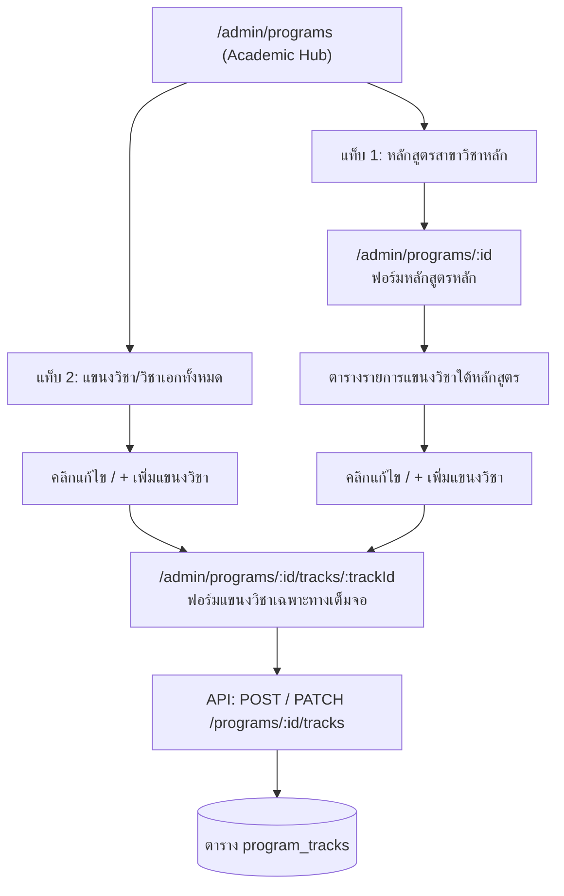

# แผนสถาปัตยกรรม: แยกตารางและฟอร์มจัดการ "หลักสูตรสาขาวิชา" และ "แขนงวิชา/วิชาเอก"

> [!NOTE] ผลการตัดสินใจเชิงสถาปัตยกรรม (Architectural Decision Record - ADR)
> 1. **Navigation Structure**: ใช้รูปแบบ **Dual Tabs** ในหน้า `/admin/programs` (แท็บ 1: สาขาวิชาหลัก, แท็บ 2: แขนงวิชา/วิชาเอกทั้งหมด) พร้อมปุ่มสร้างและตัวกรองตามสาขาวิชาหลัก
> 2. **Program Editor Integration**: ในหน้าแก้ไขหลักสูตรหลัก (`/admin/programs/[id]`) แสดง **ตารางสรุปแขนงวิชา** พร้อมปุ่ม `+ เพิ่มแขนงวิชาใหม่` และปุ่ม `แก้ไข` ที่จะเปิดไปยัง **ฟอร์มจัดการแขนงวิชาเต็มรูปแบบ (Dedicated Full-Screen Form)**
> 3. **Dedicated Track Editor**: สร้างหน้า `/admin/programs/[id]/tracks/[trackId]` สำหรับจัดการแขนงวิชาอย่างอิสระ 100% มีส่วนอัปโหลดแกลเลอรีภาพกิจกรรม, ลิงก์โซเชียลมีเดียแยกเฉพาะแขนง (TikTok, FB, IG, Line), วิดีโอแนะนำ, เล่มหลักสูตรเฉพาะ, และสถานะการรับสมัคร

---

## 1. ผังการทำงานของระบบใหม่ (System Flow)

---

## 2. โครงสร้างฟอร์มจัดการแขนงวิชาอิสระ (`/admin/programs/[id]/tracks/[trackId]`)

แต่ละแขนงวิชาจะมีฟอร์มแยกอิสระที่มีองค์ประกอบครบถ้วน:
1. **ข้อมูลระบุตัวตนและสังกัด (Identity & Affiliation)**:
   * หลักสูตรสาขาวิชาที่สังกัด (`program_id` / `program.nameTh`)
   * รหัสแขนงวิชา (`code` URL Slug เช่น `culinary-and-service`, `sociology-anthropology`)
   * ชื่อแขนงวิชา (ภาษาไทย และ ภาษาอังกฤษ)
   * ประเภทแขนง (`MAJOR` วิชาเอก, `CONCENTRATION` แขนงวิชา, `MINOR` วิชาโท)
   * รูปแบบการศึกษา (`REGULAR_4YR` แผน 4 ปีปกติ, `TRANSFER_2YR` เทียบโอน ปวส., `GRADUATE` บัณฑิตศึกษา)
   * ชื่อย่อวุฒิการศึกษาเฉพาะ (เช่น ศศ.บ., วท.บ.)
2. **สื่อประชาสัมพันธ์เฉพาะแขนง (PR Media & Social Channels)**:
   * รูปภาพ Banner ประจำแขนงวิชา (พร้อมปุ่มอัปโหลดตรงเข้าระบบ `/uploads/programs/`)
   * แกลเลอรีภาพกิจกรรมเฉพาะแขนง (Multi-Image Upload พร้อมปุ่มลบแยกรูป)
   * โซเชียลมีเดียเฉพาะแขนง (TikTok, Facebook Page, Instagram, Line Official)
   * วิดีโอแนะนำ (YouTube Video URL / Facebook Video URL)
3. **เนื้อหาเชิงวิชาการและอาชีพ**:
   * คำอธิบายปรัชญาและจุดมุ่งหมายของแขนงวิชา
   * จุดเด่น (Highlights)
   * เส้นทางอาชีพ (Careers)
   * โครงสร้างหน่วยกิต (General, Major, Free Elective, Total Credits)
   * ไฟล์เล่มหลักสูตรเฉพาะแขนง (PDF Curriculum Upload)
4. **สถานะการรับสมัครเฉพาะแขนง**:
   * กำหนดข้อความสถานะการรับสมัครเฉพาะแขนง (หากเว้นว่างจะดึงจากหลักสูตรหลัก)

---

## 3. แผนการดำเนินงานทางเทคนิค (Implementation Tasks)

### Phase 1: Backend API Enhancement
- [x] 1.1 เพิ่ม Endpoint `GET /programs/tracks/all` (หรือ Query Filter ใน `GET /programs/tracks`) เพื่อให้หน้าตารางแท็บ 2 ดึงรายการแขนงวิชาทั้งหมดพร้อมชื่อหลักสูตรต้นสังกัด
- [x] 1.2 เพิ่ม Endpoint `GET /programs/tracks/:trackId` สำหรับดึงข้อมูลแขนงวิชาเดี่ยวตาม ID เพื่อใช้ในหน้า Edit Form
- [x] 1.3 รองรับฟิลด์ `admissionStatus` ในตาราง `program_tracks` เพื่อความยืดหยุ่นสูงสุดตามความต้องการของผู้ใช้

### Phase 2: Frontend Dedicated Track Editor Page
- [x] 2.1 สร้างหน้า `frontend/app/admin/(dashboard)/programs/[id]/tracks/[trackId]/page.tsx`
- [x] 2.2 รองรับทั้งกรณีสร้างใหม่ (`[trackId] === 'new'`) และแก้ไขรายการเดิม
- [x] 2.3 ติดตั้งระบบ Upload ไฟล์ Banner, Multi-Image Gallery, PDF Curriculum, โซเชียลมีเดีย (TikTok, FB, IG, Line) และ Career Tags
- [x] 2.4 ตรวจสอบสิทธิ์ประจำสาขาวิชา (Department Scope RBAC)

### Phase 3: Dual-Tab Management Hub (`/admin/programs`)
- [x] 3.1 ปรับปรุงหน้า `frontend/app/admin/(dashboard)/programs/page.tsx` ให้มี Dual Tabs:
  - แท็บ 1: สาขาวิชาหลัก (7 หลักสูตร) พร้อมป้ายบอกจำนวนแขนงวิชา
  - แท็บ 2: แขนงวิชา/วิชาเอกทั้งหมด พร้อมฟิลเตอร์กรองตามสาขาวิชา และแผนการเรียน
- [x] 3.2 เพิ่ม Action Buttons สำหรับเปิดไปยังฟอร์มแขนงวิชาโดยตรง

### Phase 4: Program Editor Simplification (`/admin/programs/[id]`)
- [x] 4.1 แทนที่ Accordion แขนงวิชาเดิมด้วย **"ตารางสรุปแขนงวิชาประจำสาขา"** ที่สะอาด ชัดเจน
- [x] 4.2 เพิ่มปุ่ม `+ เพิ่มแขนงวิชาใหม่` และปุ่ม `แก้ไขข้อมูลแขนงวิชา` เพื่อเชื่อมไปยัง Dedicated Form
- [x] 4.3 ลดขนาดและความซับซ้อนของฟอร์มหลักสูตรหลักให้เบาและเสถียรยิ่งขึ้น

### Phase 5: Verification & End-to-End Testing
- [x] 5.1 ทดสอบสร้างและแก้ไขแขนงวิชา อัปโหลดรูปแกลเลอรี และบันทึกช่องทางโซเชียลมีเดีย
- [x] 5.2 ตรวจสอบการแสดงผลที่หน้าเว็บสาธารณะ `/programs/[code]/[track]`
