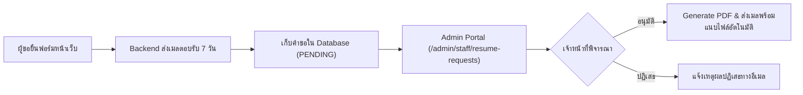

# แผนพัฒนาระบบจัดการคำขอเอกสารประวัติวิทยากรสำหรับผู้ดูแลระบบ (Admin Portal)

> [!NOTE] วัตถุประสงค์ (Objectives)
> ต่อยอดระบบขอประวัติวิทยากรและเรซูเม่อาจารย์ ([`RequestResumeModal.tsx`](file:///e:/web2026/soc-crru-web/frontend/app/about/staff/[id]/RequestResumeModal.tsx)) และ Backend API ที่สร้างไว้ ให้มีหน้าจอจัดการสำหรับผู้ดูแลระบบและเจ้าหน้าที่ธุรการคณะฯ ในส่วนหลังบ้าน ([`/admin/staff/resume-requests`](file:///e:/web2026/soc-crru-web/frontend/app/admin/(dashboard)/staff/resume-requests/page.tsx)) เพื่อตรวจสอบ อนุมัติ และจัดส่งไฟล์ PDF ได้อย่างสะดวกรวดเร็วตามเกณฑ์ PDPA ภายใน 7 วันทำการ

---

## 1. ขอบเขตงานที่พัฒนาเรียบร้อยแล้ว (Completed Scope)

### 1.1 หน้าจอผู้ดูแลระบบ (Admin Portal UI: `/admin/staff/resume-requests`)
- [x] **ตารางรายการคำขอ (Data Table):**
  - แสดงชื่อผู้ขอ, สังกัด/หน่วยงาน, อาจารย์ที่ถูกขอประวัติ, วัตถุประสงค์, วันที่ยื่นคำขอ
  - ป้ายสถานะสี (Status Badges): `PENDING` (รอตรวจสอบ - สีเหลือง), `SENT` (จัดส่งแล้ว - สีเขียว), `REJECTED` (ปฏิเสธ - สีแดง)
  - แถบเตือนนับถอยหลัง 7 วัน (7-Day SLA Countdown Timer): แจ้งเตือนนับถอยหลังคงเหลือ เช่น *"เหลือ 4 วัน"* หรือ *"เหลือ 1 วัน (ด่วน)"*
- [x] **ปุ่มพรีวิวเอกสาร (Preview PDF):**
  - เปิดดูเอกสาร PDF Resume ที่สร้างจากระบบก่อนส่งจริงได้ทันทีใน Modal
- [x] **ระบบการอนุมัติและจัดส่ง (Approve & Send Action):**
  - กดปุ่ม **"อนุมัติ & ส่ง"** → เรียก Endpoint `POST /api/staff/resume-requests/:id/approve`
  - ระบบจะสร้าง PDF แนบไปกับอีเมล `social@crru.ac.th` ถึงผู้ขอโดยอัตโนมัติ
- [x] **ระบบปฏิเสธคำขอ (Reject Action):**
  - แสดงกล่อง Modal ให้ระบุเหตุผลในการปฏิเสธเพื่อเก็บเป็นประวัติตามระเบียบ PDPA
- [x] **การเชื่อมโยงเมนูและ Badge นับจำนวน (Sidebar Integration):**
  - เพิ่มเมนู `คำขอประวัติ/วิทยากร` ภายใต้หมวด `Organization` ใน Sidebar
  - แสดงตัวเลข Badge สีส้มแจ้งเตือนจำนวนคำขอที่รอดำเนินการ (`PENDING`) โดยอัตโนมัติ
  - เพิ่มปุ่มลัดสลับไปยังหน้ารายการคำขอจากหน้าจัดการบุคลากรหลัก (`/admin/staff`)

---

## 2. ข้อมูลทางเทคนิคและ Endpoint ที่พร้อมเชื่อมต่อ (Ready APIs)

| Method | Endpoint | สิทธิ์เข้าถึง | คำอธิบาย |
|---|---|---|---|
| `GET` | `/api/staff/resume-requests` | `ADMIN`, `EDITOR` | ดึงรายการคำขอทั้งหมดพร้อม Pagination และ Status Filter |
| `POST` | `/api/staff/resume-requests/:id/approve` | `ADMIN`, `EDITOR` | อนุมัติคำขอ สร้าง PDF และส่งอีเมลแนบไฟล์ทันที |
| `POST` | `/api/staff/resume-requests/:id/reject` | `ADMIN`, `EDITOR` | ปฏิเสธคำขอพร้อมบันทึกเหตุผล |
| `GET` | `/api/staff/:id/resume-preview` | `ADMIN`, `EDITOR` | พรีวิวดาวน์โหลดไฟล์ PDF Resume ล่าสุด |

---

## 3. เอกสารและระบบที่เกี่ยวข้อง (References)
- [[docs/01_Active_Tasks/plan-staff-directory-enhancement.md|แผนงานทำเนียบบุคลากรและ PDPA Protection]]
- [`backend/apps/staff-service/src/staff.controller.ts`](file:///e:/web2026/soc-crru-web/backend/apps/staff-service/src/staff.controller.ts)
- [`backend/apps/staff-service/src/mail.service.ts`](file:///e:/web2026/soc-crru-web/backend/apps/staff-service/src/mail.service.ts)
- [`backend/apps/staff-service/src/pdf-resume.service.ts`](file:///e:/web2026/soc-crru-web/backend/apps/staff-service/src/pdf-resume.service.ts)
