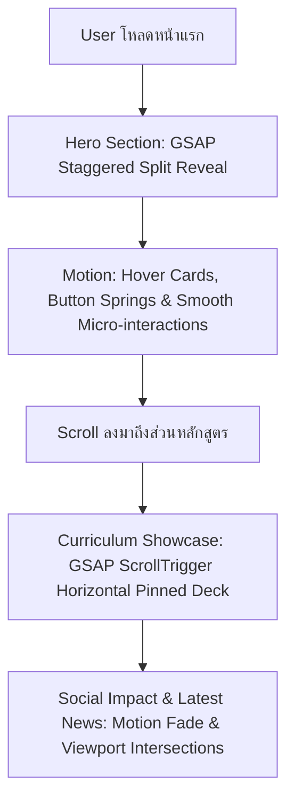

# 🎨 SOC-CRRU Design System & Color Architecture

> [!important] สถาปัตยกรรมดีไซน์สำหรับสำนักวิชาสังคมศาสตร์ มหาวิทยาลัยราชภัฏเชียงราย
> เอกสารนี้วิเคราะห์และกำหนดชุดสี (Palette), Typography, Component Tokens (Tailwind CSS v4 + shadcn/ui), และสถาปัตยกรรมแอนิเมชัน (Motion & GSAP) ตามเกณฑ์ WCAG 2.1 AA เพื่อใช้เป็นพิมพ์เขียวหลักก่อนเริ่มการพัฒนา

---

## 🏛️ 1. ดีไซน์คอนเซ็ปต์: Editorial Lanna Modernist

เราปฏิเสธ "Modern SaaS Cliché" (เลี่ยง Bento Grids สำเร็จรูป, เลี่ยง Glassmorphism ฟุ้งๆ, เลี่ยง Gradient สีม่วงนีออน) และมุ่งสู่ **Editorial Contemporary Academic**:
- **ความสุขุมทางวิชาการ (Academic Gravitas):** โครงสร้างตัวอักษรคมชัด มีจังหวะวรรคตอนแบบสิ่งพิมพ์ระดับโลก
- **อัตลักษณ์ท้องถิ่นเชียงรายร่วมสมัย (Contemporary Lanna):** นำสีพวงแสด ดอกบัวสาย และหมอกดอยมาประยุกต์ให้อยู่ในโทนหรูหราสะอาดตา

---

## 🎨 2. การวิเคราะห์และจับคู่ชุดสี (Color Palette Matrix)

| Token Name | Hex Code | สัญลักษณ์และความหมาย | การใช้งานหลัก | WCAG Contrast Ratio |
| :--- | :--- | :--- | :--- | :--- |
| **`--color-lanna-slate`** | `#0B132B` | หมึกวิชาการลุ่มลึก (Midnight Slate) | Typography หลัก, Navbar, Hero Heading | 14.8:1 บนพื้นขาว (AAA) |
| **`--color-cr-saffron`** | `#C2410C` | สีส้มพวงแสด/ดินเผาเวียงกาหลง | Primary Accent, CTA Button, Active Links | 4.8:1 บนพื้นขาว (AA Large/Normal) |
| **`--color-cr-lotus`** | `#581C87` | สีม่วงบัวสาย/มังคุด (CRRU Heritage) | Secondary Badge, Highlight, Academic Icons | 8.2:1 บนพื้นขาว (AAA) |
| **`--color-lanna-mist`** | `#F8FAFC` | สีขาวหมอกดอย (Doi Mist Canvas) | Background หลักของหน้าเพจและ Sections | สบายตา ลด Eye Strain |
| **`--color-surface-card`**| `#FFFFFF` | ขาวบริสุทธิ์พร้อมเส้นขอบคม | Card พื้นผิว, Dialogs, Dropdown Popovers | คอนทราสต์ตัดกับพื้น Mist ชัดเจน |
| **`--color-subtle-border`**| `#E2E8F0` | เทาเส้นผม (Hairline Divider) | แบ่งสัดส่วน ขอบการ์ด ไม่ใช้เงาหนัก | สร้างความคมชัดระดับ Craft |

> [!tip] กฎเหล็กการใช้สีม่วง (Purple Discipline)
> สีม่วงบัวสาย (`#581C87`) ใช้เป็น **Heritage Accent** ในจุดเล็กๆ เช่น Tag หรือ Icon เท่านั้น ห้ามนำไปทำพื้นหลัง Gradient ฟุ้งกระจาย เพื่อรักษาความน่าเชื่อถือระดับสถาบัน

---

## 🖋️ 3. ระบบตัวอักษรมาตรฐานของเว็บไซต์ (Standard Typography: Prompt)

กำหนดให้ฟอนต์ **`Prompt`** (โดย Cadson Demak / Google Fonts) เป็น **มาตรฐานหลักของเว็บไซต์ทั้งระบบ**:
* **Standard & Body Font:** `Prompt` รองรับภาษาไทยและสากล มีโครงสร้างเรขาคณิตโมเดิร์น โปร่ง สบายตา เข้ากับงานสถาบันการศึกษายุคใหม่
* **Numbers & Latin Accent:** `Inter` สำหรับรหัสวิชา ตัวเลขสถิติ และคำศัพท์เฉพาะทาง
* **Weights:** `300` (Light), `400` (Regular), `500` (Medium), `600` (Semi-Bold), `700` (Bold)
* **Fluid Heading:** พาดหัวระดับใหญ่ใช้ `font-bold font-heading` คมชัดทุกขนาดหน้าจอ

---

## 🎯 4. ระบบไอคอนสากล (Unified Iconography - Lucide React)

กำหนดให้โปรเจกต์ใช้ **`lucide-react`** เป็นมาตรฐานเดียวทั้งระบบ (Single Source of Truth) เพื่อความเป็นเอกภาพและความคมชัด:
- **Stroke Width:** กำหนดไว้ที่ `1.75` หรือ `1.5` (ห้ามใช้เส้นหนาเกินไปจนดูเทอะทะ)
- **Size Scale:**
  - Micro / Inline Icon: `size-3.5` หรือ `size-4` (14px - 16px) สำหรับ Badge และ Meta info
  - Action / Button Icon: `size-4` หรือ `size-4.5` (16px - 18px)
  - Feature / Section Icon: `size-5` หรือ `size-6` (20px - 24px)
  - Showcase / Hero Icon: `size-8` ถึง `size-10` (32px - 40px)
- **Accessibility:** ไอคอนที่เป็นปุ่มหรือลิงก์เดี่ยวต้องมี `aria-label` หรือ `<span className="sr-only">` กำกับเสมอ

---

## 🧩 5. โครงสร้าง Design Tokens (Tailwind CSS v4 & shadcn/ui)

```css
@theme inline {
  --color-background: var(--background);
  --color-foreground: var(--foreground);
  --color-primary: var(--primary);
  --color-primary-foreground: var(--primary-foreground);
  --color-accent: var(--accent);
  --color-muted: var(--muted);
  --color-muted-foreground: var(--muted-foreground);
  --color-border: var(--border);
  --radius-lg: 0.75rem;
  --radius-md: 0.5rem;
  --radius-sm: 0.25rem;
}
```

---

## ⚡ 6. แผนผัง Motion & Interactive Showcase (หน้าแรก)



1. **Section 1: Hero Entrance (GSAP)**
   - Text Masking Reveal: ตัวอักษรภาษาไทยและอังกฤษคลี่ตัวขึ้นจากเบื้องหลัง
   - Subtle Floating Elements: เลเยอร์ภาพอัตลักษณ์เชียงรายขยับแบบ Parallax อ่อนโยน
2. **Section 2: Interactive Curriculum Deck (GSAP ScrollTrigger)**
   - เมื่อ Scroll มาถึงจุดนี้ หน้านิ่งล็อก (Pinned) แล้วเลื่อนการ์ดสาขาวิชาในแนวนอน 
   - ภายในตัวการ์ด ใช้ **Motion** สำหรับ Hover Tilt และแสดงผล Track / Concentration
3. **Accessibility Fallback:**
   - เมื่อตรวจพบ `@media (prefers-reduced-motion: reduce)` แอนิเมชันทั้งหมดจะปลด Pinning และเปลี่ยนเป็น Static Grid ที่สะอาดตา 100%

---

## 🔗 เอกสารเชื่อมโยง
- [[00_Dashboard|สารบัญหลัก (MOC)]]
- [[04_Webometrics_Guidelines/02_Technical_SEO_Checklist|มาตรฐาน Technical SEO & Webometrics]]
